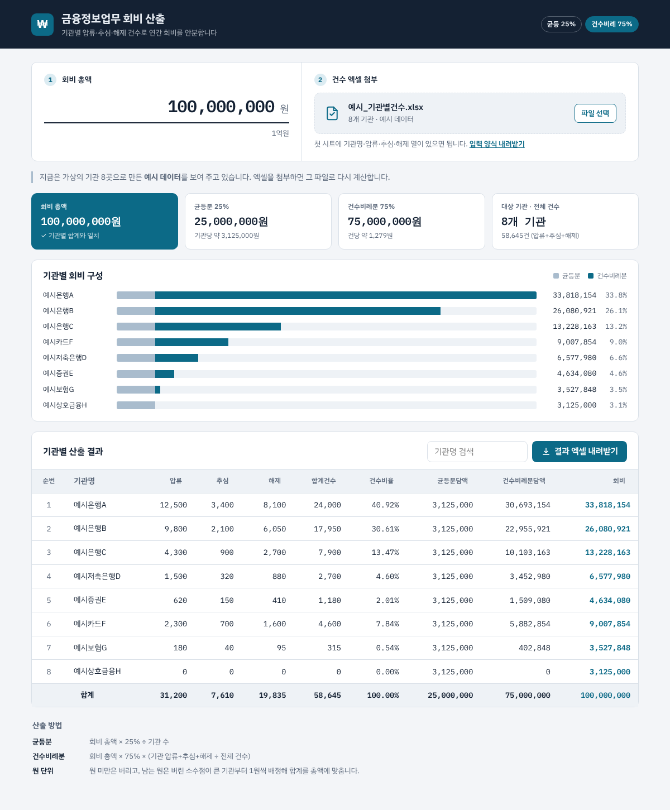

# Day01 — 금융정보업무 회비 산출 (대용)

- **날짜**: 2026-10-17
- **바로 써 보기**: [`release/fee-calculator.html`](release/fee-calculator.html) 파일을 내려받아 브라우저로 열면 설치 없이 동작 (claude.ai 웹 페이지로도 게시)
- **도구**: Claude Code
- **한 줄 소개**: 회비 총액을 입력하고 기관별 압류·추심·해제 건수 엑셀을 올리면, 기관별 회비를 안분한 결과 엑셀을 만들어 주는 웹 화면

## 만든 것

### 안분 규칙
1. 회비 총액은 사용자가 입력한다.
2. 총액의 **25%(균등분)** 는 업로드한 엑셀의 모든 기관에 똑같이 나눈다.
3. 나머지 **75%(건수비례분)** 는 기관별 `압류 + 추심 + 해제` 건수가 전체 건수에서 차지하는 비율로 나눈다.
4. 기관별 회비 = 균등분담액 + 건수비례분담액.

### 원 단위 처리 (기본값)
- 균등분 총액 = `round(총액 × 25%)`, 건수비례분 총액 = `총액 − 균등분 총액`.
- 각 풀에서 기관별 금액의 원 미만은 버리고, 남는 원(단수)은 소수점 이하가 큰 기관부터 1원씩 더한다(최대잔여법). 소수점 이하가 같으면 엑셀 순서가 앞선 기관이 먼저 받는다.
- 그래서 기관별 회비의 합은 항상 입력한 총액과 정확히 같다.

### 입력 엑셀 형식
- 첫 번째 시트를 읽는다. 머리글 행에 `압류`, `추심`, `해제`가 들어간 열이 있어야 한다(`압류건수`, `압류 건수` 등 허용). 머리글 위의 제목 행은 건너뛴다.
- 기관명 열은 `기관명/기관/참가기관/회원사/은행명` 중 하나로 찾고, 없으면 남은 첫 열을 기관명으로 쓴다.
- `합계` 열은 있어도 되고 없어도 된다. 계산에는 항상 `압류+추심+해제`를 쓰고, 파일의 합계와 다르면 경고를 띄운다.
- 기관명이 비어 있는 행과 `합계/총계/소계` 행은 무시한다. 숫자에 콤마가 있어도 된다.
- 예시 양식: 화면의 "입력 양식 내려받기" (가상의 기관·건수)

### 결과 엑셀
`회비산출결과_YYYYMMDD.xlsx`
- `회비산출결과` 시트: 순번, 기관명, 압류·추심·해제·합계 건수, 건수비율(%), 균등분담액, 건수비례분담액, 회비, 합계 행
- `산출기준` 시트: 산출일, 원본 파일명, 총액, 기관 수, 균등분/건수비례분 총액, 전체 건수, 원 단위 처리 방식

### 화면
- 상단: 회비 총액 입력(1억 2,345만 원처럼 한글 금액 표시) 옆에 엑셀 첨부란(끌어다 놓기 지원)
- 처음 열면 가상 기관 8곳의 예시 데이터로 결과를 미리 보여 주고, 엑셀을 첨부하면 그 파일로 다시 계산
- 요약 카드(총액·균등분·건수비례분·기관 수/건수, 기관별 합계와 총액 일치 여부), 기관별 회비 구성 막대, 정렬·검색 가능한 결과 표
- 결과 엑셀과 입력 양식 엑셀 내려받기. 계산은 총액이나 파일이 바뀌면 바로 다시 한다
- 밝은/어두운 화면, 휴대폰 폭 지원

### 실행 방법
```bash
npm install
npm run dev      # 개발 서버 http://localhost:5173
npm test         # 안분 계산·엑셀 파싱 테스트 (node:test)
npm run build    # dist/ + release/fee-calculator.html(단일 파일 프로그램) 생성
```
브라우저 안에서만 계산하며 업로드한 파일은 서버로 보내지 않는다. 단일 파일은 인터넷이 없어도 동작한다(글꼴만 기본 글꼴로 바뀜).

### 구성
- `src/feeCalc.js` 안분 계산(순수 함수)
- `src/excel.js` 엑셀 읽기(머리글 자동 인식)·결과/양식 엑셀 만들기·저장 (SheetJS)
- `src/sampleData.js` 예시 데이터(가상 기관)
- `src/App.jsx`, `src/styles.css` 화면
- `scripts/build-single.js` 빌드 결과를 HTML 파일 하나로 묶기

## 사용한 프롬프트 / 과정
- 회비 총액 입력 + 건수 엑셀 업로드 → 25% 균등 / 75% 건수 비율로 안분 → 결과 엑셀 자동 생성 요청
- 명시되지 않은 원 단위 처리는 최대잔여법으로 정하고 결과 엑셀 `산출기준` 시트에 기록
- 2차: 화면을 프로그램 형태로 다듬고(요약·구성 막대·정렬/검색 표·끌어다 놓기·다크 모드), 설치 없이 여는 단일 HTML 파일로 묶음

## 배운 점

## 스크린샷

