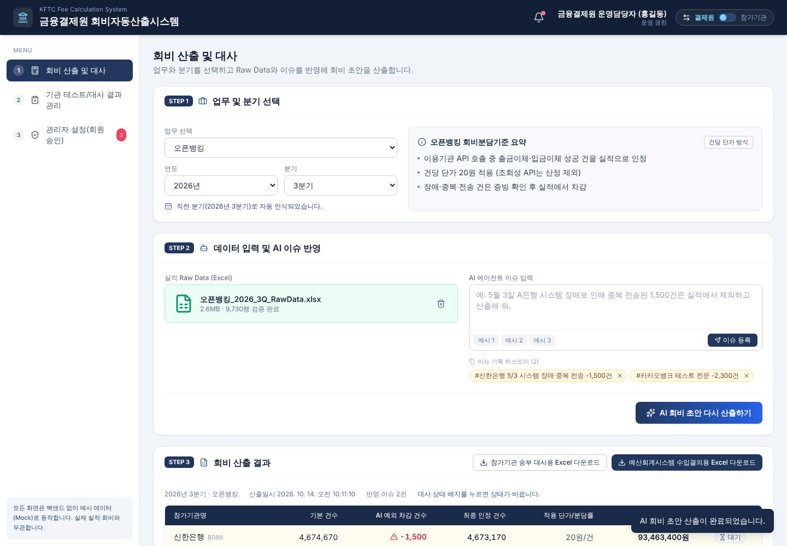
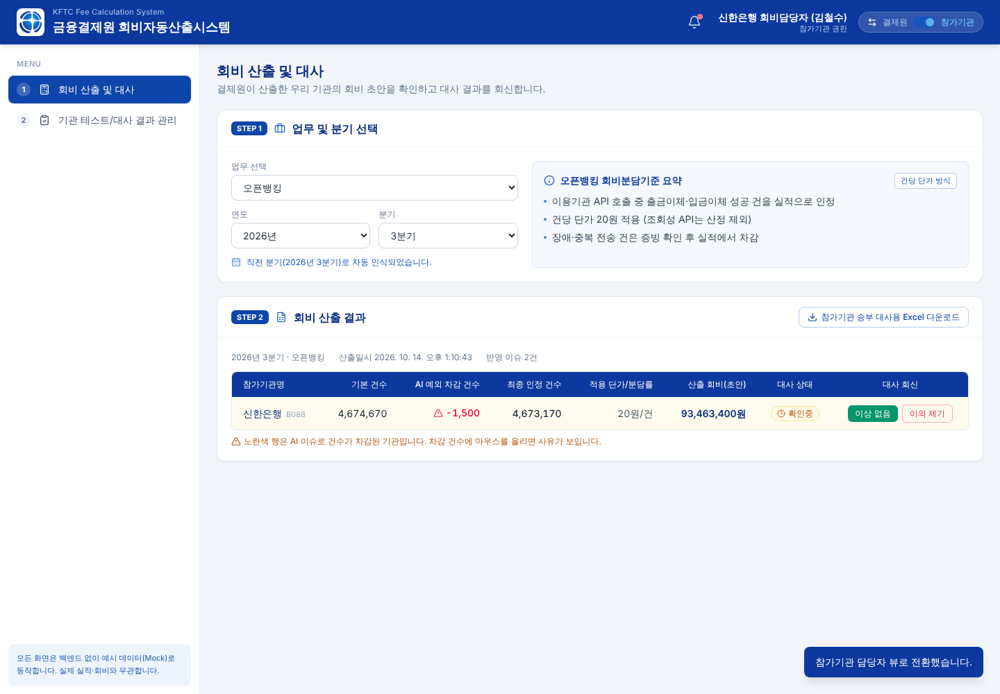

# Day01 — 금융결제원 회비자동산출시스템 (경식)

- **날짜**: 2026-10-14
- **도구**: Claude Code
- **한 줄 소개**: 업무·분기별 회비를 Raw Data와 AI 이슈(예외 차감)를 반영해 산출하고, 대사·수입결의용 Excel로 내려받는 프론트엔드 시안

## 만든 것
백엔드 없이 예시 데이터(Mock)와 React state만으로 동작하는 단일 페이지 앱입니다.

| 메뉴 | 내용 |
|------|------|
| 로그인 | 앱은 로그인 화면(`isLoggedIn = false`)에서 시작. 넓은 화면(1024px 이상)은 좌우 5:5 분할로 왼쪽에 CSS 3D 회전·부유·반짝임 로고, 좁은 화면은 폼만 보이고 미니 로고 표시. 역할별 시연 계정으로 로그인(아래 표), 계정별 5회 연속 오입력 시 잠금(시연용 잠금 초기화 버튼, 관리자 화면 잠금 해제). 헤더의 [로그아웃]으로 돌아옴 |
| 회비 산출 및 대사 | STEP 1 업무(오픈뱅킹·금거정·CMS·CD공동망·타행환)와 산출 기간(From~To) 선택, 회비분담기준 요약 → STEP 2 Excel 업로드 시뮬레이션, AI 이슈 입력·태그 히스토리, 초안 산출(로딩 애니메이션) → STEP 3 결과 테이블, 차감 행 하이라이트·사유 툴팁, Excel 2종 다운로드 |
| 기관 테스트/대사 결과 관리 | 산출된 모든 업무·분기의 대사 현황(대기/확인중/완료), 기관 연동 테스트 결과와 재테스트 |
| 내 정보 관리 | 기본 인사 정보·내선번호 수정, 담당 업무 현황과 업무 권한 추가 신청·신청 내역, Mattermost 알림 설정(테스트 발송은 토스트만), 비밀번호 변경·최근 접속 이력 |
| 관리자 설정 | 시스템관리자만. **회원 관리**: 모든 회원 추가·수정·삭제(본인 삭제·권한 변경 불가), 비밀번호 초기화, 가입 신청 승인·반려, 5회 오류 잠금 해제, 상태 필터·검색. **업무 권한 관리**: 권한 신청 승인·반려, 회원별 업무 권한 부여·해제(해당 회원의 산출 드롭다운에 바로 반영) |

- **좌측 메뉴**: 헤더의 세 줄(☰) 버튼이나 `[` 키로 접고 펼칩니다(입력창에 타이핑 중일 때는 `[` 키가 동작하지 않음). 접으면 아이콘만 남고, 아이콘에 마우스를 올리면 메뉴와 하위 메뉴가 떠서 보입니다. 하위 메뉴를 누르면 해당 화면의 그 영역으로 이동합니다.
  - 회비 산출 및 대사: 업무 및 기간 선택 / 데이터 입력 및 AI 이슈(결제원 뷰만) / 산출 결과 및 다운로드
  - 기관 테스트/대사 결과 관리: 회비 대사 현황 / 기관 연동 테스트 결과
  - 내 정보 관리: 기본 정보 / 담당 업무 및 산출 권한 / Mattermost 알림 설정 / 보안 설정 및 접속 이력 (하위 메뉴마다 별도 페이지, 상위 메뉴는 기본 정보로 이동)
  - 관리자 설정: 회원 관리 / 업무 권한 관리 (하위 메뉴마다 별도 페이지, 상위 메뉴는 회원 관리로 이동)
- **역할과 시연 계정** (기본 비밀번호 모두 `1234`, 마이페이지에서 변경 가능)

  | ID | 권한 | 첫 화면 | 메뉴 |
  |----|------|--------|------|
  | `hong` | 사용자 (금융결제원 일반담당자 홍길동) | 회비 산출 및 대사 | 회비 산출(승인된 업무만: 오픈뱅킹·금거정), 기관 테스트/대사 결과 관리, 내 정보 관리(권한 신청) |
  | `admin` | 관리자 (금융결제원 시스템관리자 이수진) | 관리자 설정 | 관리자 설정, 회비 산출(모든 업무), 기관 테스트/대사 결과 관리, 내 정보 관리 |
  | `shinhan` | 참가기관 (신한은행 김철수) | 회비 대사 확인 | 회비 대사 확인(자기 기관 행·대사 회신), 테스트/대사 결과 조회, 내 정보 관리 |

  그 밖의 예시 회원: `kimms`(사용자, CMS·타행환 권한), 잠긴 계정 `woori01`·`ibk02`, 가입 승인대기 `hana01`·`toss01`·`choisy`(승인 전에는 로그인 불가). 관리자가 추가한 회원도 바로 로그인할 수 있습니다.

  화면은 로그인한 계정의 권한으로만 정해집니다. 역할 전환 토글은 없고, 헤더에 권한 배지(사용자·관리자·참가기관)가 표시됩니다. 다른 권한 화면은 로그아웃 후 해당 계정으로 로그인해서 봅니다.
- **업무별 산출 권한(RBAC)**: 일반담당자는 STEP 1 업무 드롭다운에서 승인된 업무만 고를 수 있고, 나머지는 「(권한 없음 - 신청 필요)」로 비활성화됩니다. 옆의 [+ 담당 업무 추가 신청]은 내 정보 관리로 이동합니다. 시스템관리자가 관리자 설정 › 업무 권한 관리에서 승인(또는 직접 부여)하면 바로 선택할 수 있고, 해제하면 바로 비활성화됩니다.
- **산출 기간**: 시작일(From)·종료일(To)을 달력에서 고르거나 숫자 8자리(예: `20260701`)로 입력합니다(하이픈 자동 입력, `2026.7.1` 같은 값 붙여넣기 가능). 없는 날짜(2월 30일, 13월 등)와 형식 오류는 칸 아래에, From이 To보다 늦으면 경고 상자에 표시하고 산출을 막습니다. 기본값은 직전 분기이고 빠른 선택(직전 분기·최근 1개월·올해 누적·올해 지난 분기)이 있습니다. 정확히 한 분기가 아니면 분기 기준 실적·총액을 일수 ÷ 91일 비율로 환산합니다.
- **AI 이슈 해석**: 문장에서 기관명(또는 A~H은행 가명)과 `N건`을 찾아 차감합니다. 시연용 가명 매핑은 A은행=신한은행, B은행=KB국민은행 … 순서입니다 (`src/data/mockData.js`).
- **산출 방식**: 건당 단가 방식(오픈뱅킹·CMS·타행환)은 최종 인정 건수 × 단가, 총액 분담 방식(금거정·CD공동망)은 분기 총액 × 인정 건수 비율.
- **대사 상태**: 결제원 뷰에서 상태 배지를 누르면 대기→확인중→완료로 바뀌고, 「참가기관 송부 대사용」을 내려받으면 대기 기관이 확인중으로 바뀝니다.
- **Excel**: SheetJS(xlsx)로 브라우저에서 생성합니다. 대사용 파일은 대사내역·산출기준·AI 이슈 이력 3개 시트, 수입결의용은 결의일자·수입과목·거래처·금액·적요 형식입니다.

> 기관 실적, 단가, 총액, 신청자 정보는 모두 화면 시연용 예시이며 실제 데이터와 무관합니다.

## 실행 방법
Node.js 18 이상이 필요합니다.

```bash
cd day01-gyeongsik-fee-calculator
npm install
npm run dev      # http://localhost:5173
npm run build    # dist/ 에 정적 파일 생성
```

백엔드와 함께 띄우려면 `backend/`에서 `mvn spring-boot:run`을 실행한 뒤 `VITE_API_BASE_URL=http://localhost:8080 npm run dev`로 화면을 띄웁니다. 이 값이 없으면 화면은 예시 데이터(Mock)만으로 동작합니다.

## 공개 배포 (Vercel)
- 주소: https://vibe-coding-challenge-nine.vercel.app/
- Vercel 프로젝트를 이 GitHub 저장소에 Git 연결해 두면, `main`에 push·병합될 때마다 프로덕션이 자동으로 다시 배포되고 PR·`claude/*` 브랜치 push는 미리보기 배포가 만들어집니다.
- Vercel 프로젝트 설정: Root Directory `day01-gyeongsik-fee-calculator`, Framework Preset `Vite`, Build Command `npm run build`, Output Directory `dist`, Production Branch `main`.
- 토큰이나 비밀값은 저장소에 넣지 않습니다 (Git 연결 방식은 필요 없음).
- 백엔드 연결: Vercel 프로젝트 Settings → Environment Variables에 `VITE_API_BASE_URL` = 백엔드 공개 주소(예: `https://vibe-coding-challenge.onrender.com`, 끝에 `/` 없이)를 넣고 다시 배포합니다. Vite는 빌드할 때 이 값을 넣으므로 값을 바꾸면 Redeploy가 필요합니다. 백엔드 배포는 [backend/README.md](backend/README.md#공개-배포-render)를 보세요.

## 색상·로고
로그인 화면·헤더 로고와 파비콘은 금융결제원 CI 심벌마크(`public/kftc-symbol.png`, 가이드 이미지에서 잘라 배경을 투명하게 처리)입니다. 색상은 심벌의 그라데이션에서 뽑았습니다. 짙은 블루 `#0E45AA`·`#0D389E`를 주색(`brand`), 밝은 블루 `#178CDC`를 보조색(`accent`)으로 쓰며 `tailwind.config.js`에서 관리합니다.

## 백엔드 API
`backend/` 폴더에 Spring Boot API 서버(로그인·5회 잠금, 업무 권한 RBAC, 회비 산출·엑셀, 대사·수행률·Mattermost 알림)가 있습니다. 실행 방법과 API 목록은 [backend/README.md](backend/README.md)를 보세요. `VITE_API_BASE_URL`이 설정되면 로그인(5회 잠금 포함)·회원 관리(가입 승인·반려, 잠금 해제, 비밀번호 초기화, 부서·이메일·내선 수정)·업무 권한 신청·승인·부여·해제가 서버(`src/utils/api.js`)와 연동됩니다. 회원 이름·역할 변경, 회원 추가·삭제, 회비 산출·대사 화면은 아직 화면 안의 예시 데이터로만 동작합니다.

## 기술 스택
Vite 5, React 18, Tailwind CSS 3, lucide-react, xlsx(SheetJS)

## 폴더 구조
```
src/
  App.jsx                          레이아웃, 로그인·역할·업무 권한·산출 결과 공유 상태
  components/LoginPage.jsx         로그인 화면(로고 쇼케이스, 5회 잠금)
  components/Layout.jsx            헤더(권한 배지·로그아웃), 사이드바
  components/FeeCalculation.jsx    메인 화면 STEP 1~3
  components/DateField.jsx         날짜 입력칸(숫자 입력·달력 선택)
  components/ResultsManagement.jsx 테스트/대사 결과 관리
  components/MyPage.jsx            내 정보 관리(마이페이지)
  components/AdminSettings.jsx     관리자 설정: 회원 관리(추가·수정·삭제·가입 승인·잠금 해제), 업무 권한 관리
  data/mockData.js                 역할·회원(계정)·업무·기관·기준 예시 데이터
  utils/fee.js                     AI 이슈 파서, 회비 계산
  utils/excel.js                   Excel 2종 생성
  utils/period.js                  산출 기간 날짜 검증·분기 계산
```

## 사용한 프롬프트 / 과정
금융권 React 프론트엔드 개발자 역할로, 헤더·사이드바 레이아웃과 회비 산출 3단계(업무·분기 선택 → 데이터·AI 이슈 입력 → 결과 테이블·Excel 다운로드)를 Mock Data로 인터랙티브하게 구현해 달라고 요청.

## 배운 점
- 업무·기간·기관을 시드로 쓰는 결정적 난수로 Mock 실적을 만들면, 분기를 바꿨다 돌아와도 같은 값이 나와 시연이 자연스럽다.

## 스크린샷


| 결제원 담당자 뷰 | 참가기관 담당자 뷰 |
|---|---|
|  |  |
