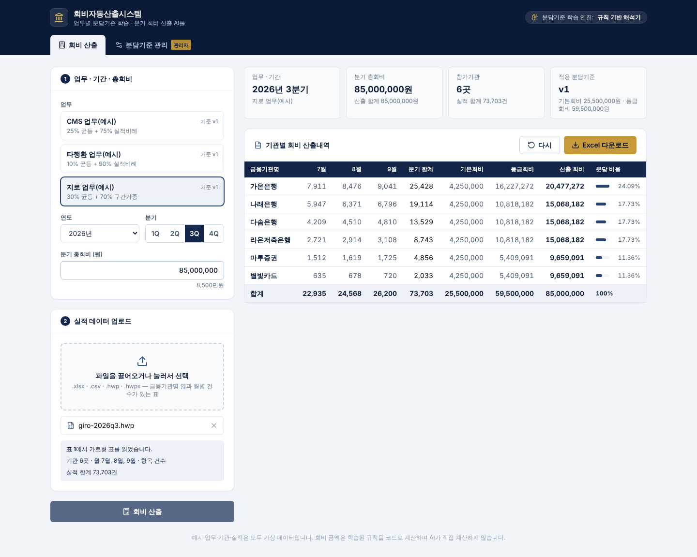
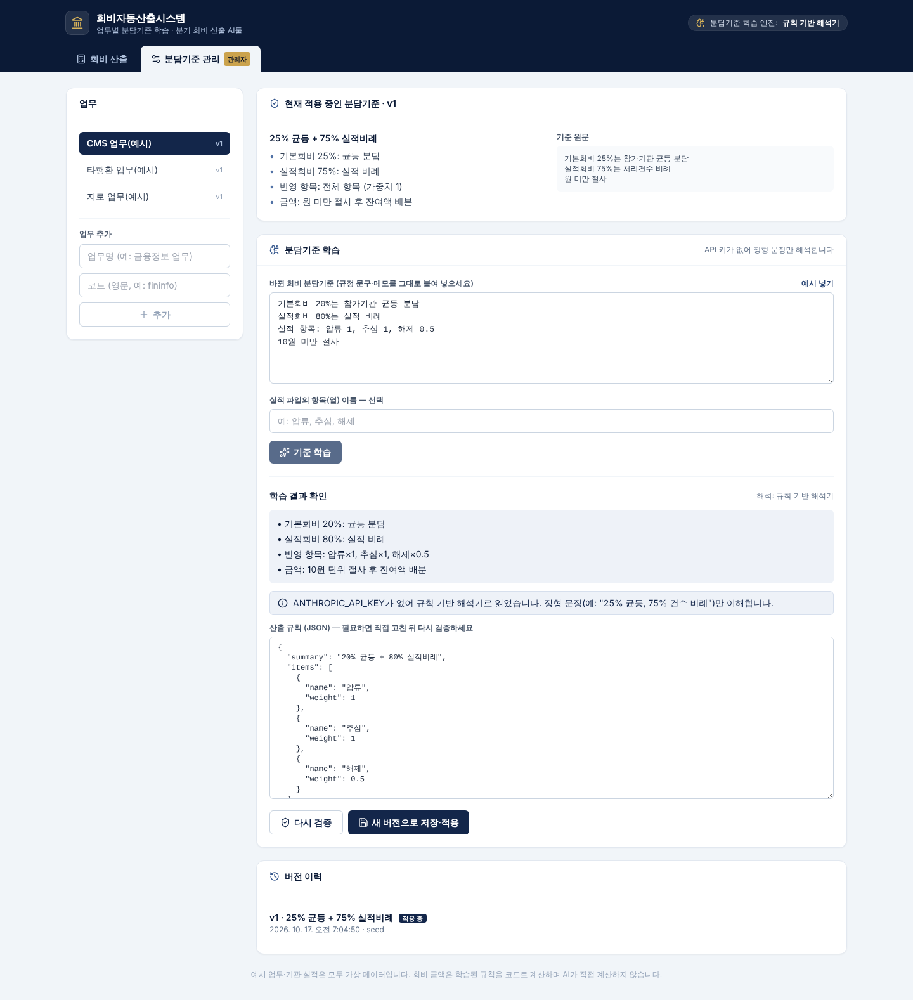

# Day01 — 회비자동산출 AI툴 (우성)

- **날짜**: 2026-10-17
- **도구**: Claude Code
- **한 줄 소개**: 업무별 회비 분담기준을 AI로 학습(규칙화)해 두고, 업무·분기·총회비와 실적 파일(Excel·CSV·HWP·HWPX)을 넣으면 기관별 분기 회비를 산출해 Excel로 내려주는 「회비자동산출시스템」 백엔드 AI툴과 화면

> 예시 업무(CMS·타행환·지로)의 분담기준, 기관명, 실적은 모두 **가상 데이터**입니다. 실제 금융결제원 기준이나 회원 정보가 아닙니다.

## 만든 것

### 흐름

```
[관리자] 분담기준 문구 입력 ──► 기준 학습(Claude) ──► 산출 규칙(JSON) 확인·수정 ──► 새 버전으로 저장·적용
                                                                                  │
[사용자] 업무·연도·분기 선택 + 총회비 입력 + 실적 파일 업로드 ──► 규칙대로 산출 ◄─┘ ──► 결과 표 / Excel 다운로드
```

- **분담기준 학습**: 관리자가 바뀐 기준을 규정 문구 그대로 붙여 넣으면 Claude가 계산 엔진이 실행할 수 있는 **산출 규칙(JSON)** 으로 옮깁니다. 엔진이 표현할 수 없는 조항(최저회비 등)은 근사하지 않고 `notes`에 '미반영'으로 남깁니다. 관리자가 결과를 확인(필요하면 JSON 직접 수정)한 뒤 저장해야 적용되며, 저장할 때마다 버전이 쌓이고 이전 버전으로 되돌릴 수 있습니다.
- **산출은 AI가 아니라 코드가**: 금액 계산은 학습된 규칙을 결정적 코드로 실행합니다. 같은 입력이면 항상 같은 결과가 나오고, 기관별 회비 합계는 총회비와 1원도 다르지 않습니다.
- `ANTHROPIC_API_KEY`가 없으면 정형 문장(예: `25% 균등, 75% 건수 비례`)만 읽는 **규칙 기반 해석기**로 대신 동작합니다. 키 없이도 전체 흐름을 시연할 수 있습니다.

### 산출 규칙이 표현하는 것

| 요소 | 내용 |
|---|---|
| 구성요소(`components`) | 총회비를 비율(`ratio`, 합계 100%)로 나눈 덩어리. 방식은 `equal`(참가기관 균등), `proportional`(반영실적 비례), `tiered`(분기 반영실적 구간별 가중치) |
| 실적 항목(`items`) | 반영할 항목과 건당 가중치(예: 송금 1, 조회 0.2). 비우면 모든 항목을 가중치 1로 반영 |
| 금액 단위(`rounding.unit`) | 1·10·100·1000원. 단위 미만은 절사 후 최대잔여법으로 배분, 단위로 나누어떨어지지 않는 자투리는 가중치가 가장 큰 기관에 배정 |

### 계산 방법

1. 분기 총회비를 구성요소 비율대로 나눕니다(원 단위 최대잔여법).
2. 구성요소마다 기관 가중치(균등=1, 비례=반영실적, 구간=해당 구간 가중치)로 안분합니다. 정수(BigInt)로만 계산해 부동소수점 오차가 없습니다.
3. 기관별 구성요소 금액을 더해 산출 회비를 만들고, 합계가 총회비와 같은지 검증합니다.
4. 반영실적 = Σ(월별 항목 건수 × 항목 가중치). 선택한 분기 밖의 실적, 규칙에 없는 항목은 빼고 화면·Excel에 '확인 사항'으로 알립니다.

### 실적 파일

| 형식 | 읽는 방법 |
|---|---|
| `.xlsx` | 모든 시트에서 실적 표를 찾음(수식은 계산 결과값 사용) |
| `.csv` | UTF-8, CP949(EUC-KR) 자동 판별 |
| `.hwp` | 한글 5.0 바이너리 문서의 표 (암호·배포용 문서 제외) |
| `.hwpx` | 한글 OWPML 문서의 표 |

표 모양은 아래 셋 중 하나면 됩니다. 머리글 행은 위쪽 15줄 안에서 `금융기관명`(기관명·은행명·참가기관 등) 열을 찾아 정하고, `합계`·`비고` 행/열은 건너뜁니다.

```
가로형          금융기관명 | 7월 | 8월 | 9월
가로형(항목)    금융기관명 | 항목 | 7월 | 8월 | 9월
세로형          금융기관명 | 기준월 | 송금 | 조회     (기준월: 2026-07, 2026.07, 7월 등)
```

### Excel 산출내역

- **회비산출내역** 시트: 금융기관명, 월별 실적건수, 분기 합계, (가중치가 있으면) 반영실적, 구성요소별 금액, 산출 회비, 분담 비율, 합계 행
- **산출기준** 시트: 업무·기간·총회비, 적용한 분담기준 버전과 설명, 기준 원문, 확인 사항

## 실행

```bash
cd day01-woosung-fee-ai
npm install
npm run dev        # API(8787) + 화면(5173) 동시 실행 → http://localhost:5173
```

- Claude로 학습: `ANTHROPIC_API_KEY=... npm run dev` (모델은 `FEE_AI_MODEL`, 기본 `claude-opus-5-5`)
- 배포형 실행: `npm run build && npm start` → http://localhost:8787 (API와 화면을 한 서버가 제공)
- 테스트: `npm test` (안분·산출, 파일 파서, API 흐름. Claude API는 가짜 서버로 대체)
- 예시 실적 파일 다시 만들기: `npm run samples` → `samples/`

예시 실적 파일(`samples/`, 모두 2026년 3분기):

| 파일 | 업무 | 표 모양 |
|---|---|---|
| `cms-2026q3.xlsx`, `cms-2026q3.csv` | CMS | 가로형 |
| `interbank-2026q3.xlsx` | 타행환 | 세로형(송금·조회) |
| `giro-2026q3.hwp`, `giro-2026q3.hwpx` | 지로 | 한글 문서 속 가로형 표 |

> `giro-2026q3.hwp/.hwpx`는 파서 시연용으로 표만 담아 만든 최소 구조 파일이라 한글 프로그램에서는 열리지 않을 수 있습니다. 실제 한글에서 만든 문서의 표도 같은 방식으로 읽습니다.

### API (백엔드 연동용)

| 메서드 | 경로 | 설명 |
|---|---|---|
| GET | `/api/works` | 업무 목록과 적용 중인 분담기준 |
| POST | `/api/works` | 업무 추가 `{ code, name }` |
| GET | `/api/works/:code/criteria` | 분담기준 버전 이력 |
| POST | `/api/works/:code/criteria/learn` | 기준 문구 학습 → 규칙 초안(저장 안 함) `{ text, hint? }` |
| POST | `/api/works/:code/criteria` | 규칙을 새 버전으로 저장·적용 `{ rule, sourceText, engine }` |
| POST | `/api/works/:code/criteria/:version/activate` | 이전 버전 다시 적용 |
| POST | `/api/performance/parse?filename=&year=` | 실적 파일(본문 바이너리) → 실적 레코드 |
| POST | `/api/fees/calculate` | `{ workCode, year, quarter, totalFee, records }` → 산출 결과 |
| POST | `/api/fees/export` | 같은 입력 → 산출내역 `.xlsx` |

분담기준은 `data/works.json`에 저장됩니다(처음 실행 시 예시 업무로 생성, git 제외). 운영 시스템에 붙일 때는 `server/store.js`만 DB 저장소로 바꾸면 됩니다.

### 폴더 구조

```
server/
  engine/    rules.js(규칙 스키마·검증) · learn.js(Claude/규칙 기반 학습) · calculate.js · allocate.js(BigInt 안분) · period.js
  parsers/   excel.js · hwp.js · hwpx.js · table.js(표 → 실적 레코드)
  export.js  산출내역 Excel 생성
  store.js   업무·분담기준 버전 저장
  index.js   Express API
src/         React + Tailwind + lucide-react 화면 (회비 산출 / 분담기준 관리)
scripts/     예시 실적 파일 생성
test/        node --test
```

## 알려진 제한

- 예전 엑셀(`.xls`), HWP 3.0 이하, 암호·배포용 HWP는 읽지 않습니다(`.xlsx`나 일반 HWP로 다시 저장).
- 최저회비·상한·기관별 감면처럼 위 세 가지 방식으로 표현되지 않는 조항은 학습 결과 `notes`에 '미반영'으로만 남습니다. 필요하면 엔진에 방식을 추가해야 합니다.
- 화면에 로그인·권한은 없습니다(관리자 탭은 표시만 구분).
- `npm audit`에 exceljs가 쓰는 uuid의 moderate 경고가 있습니다(버퍼 인자를 쓰는 경우에만 해당, 이 툴은 해당 없음).

## 사용한 프롬프트 / 과정

- 요구: 업무별 회비 분담기준 학습·재학습, 업무·기간·총회비 입력, excel/hwp 실적 업로드, 기준대로 기관별 회비 산출, 금융기관명·월별 실적건수·산출 회비가 담긴 Excel 다운로드
- 설계 결정: 금융 산출이므로 AI는 '기준 문구 → 구조화 규칙' 변환에만 쓰고(Claude 구조화 출력), 금액 계산은 결정적 코드로. 학습 결과는 관리자 확인 후 버전으로 저장

## 배운 점

- 회비 안분은 원 단위 단수 처리가 핵심이라 BigInt + 최대잔여법으로 합계를 보장하고, 동률은 이름순으로 정해 결과를 재현 가능하게 했다.
- HWP 5.0은 OLE 복합 문서 안의 레코드 스트림이라, 표 컨트롤(`tbl `) 아래 셀 리스트 헤더의 행·열 주소를 따라가면 표를 복원할 수 있다.

## 스크린샷

회비 산출 (지로 업무 예시, HWP 실적 업로드)



분담기준 관리 (기준 학습 → 규칙 확인 → 버전 저장)


