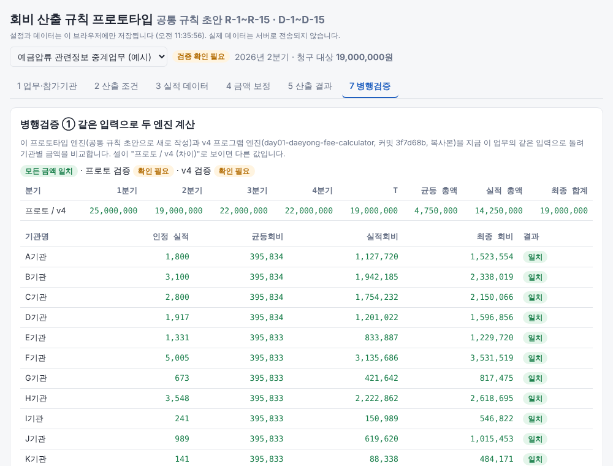

# Day02 — 회비 산출 규칙 프로토타입 (대용, 병행검증용)

- **날짜**: 2026-10-22
- **도구**: Claude Code
- **한 줄 소개**: [공통 규칙 초안](../day01-daeyong-fee-calculator/docs/COMMON_RULES_DRAFT.md)(R-1~R-15, D-1~D-15)만 보고 **처음부터 다시 쓴** 회비 산출 프로그램. 기존 v4 프로그램(`day01-daeyong-fee-calculator`)과 같은 입력으로 결과를 맞춰 보는 병행검증 기능이 붙어 있다.
- **바로 써 보기**: [`release/fee-rules-proto.html`](release/fee-rules-proto.html)을 내려받아 브라우저로 열면 설치 없이 오프라인으로 동작 (claude.ai 웹 페이지로도 게시)

## 왜 따로 만들었나

v4는 통합 요구사항을 보고 만든 구현이고, 이 프로토타입은 거기서 뽑아낸 **공통 규칙 문서**를 보고 만든 두 번째 구현이다. 서로 다른 코드가 같은 입력에서 같은 금액을 내면 규칙 문서가 구현 가능할 만큼 충분히 구체적이라는 뜻이고, 다르면 문서나 둘 중 한 구현에 빈틈이 있다는 뜻이다. 그래서 v4 코드는 참고하지 않고 규칙 번호를 코드에 그대로 달아 가며 작성했다.

## 만든 것

```
rules/            계산 규칙 (화면과 무관, node:test로 검증)
  money.js        R-1.1  BigInt 정수 계산, 원 미만 처리(내림·반올림·올림), 10원 단위
  decisions.js    9장    D-1 ~ D-15 담당자 확인 항목 (기본값·선택지·확인 여부)
  schedule.js     R-4    A·B·C → D·E → 분기별 청구 대상 총액 (방식 A/B, 차액 분기)
  allocate.js     R-3,5,6,7  균등회비(방식 A/B) → 실적회비 → 원 단위 잔액 → 우체국 10원 처리, 기관별 근거(trace) 기록
  verify.js       R-12   검증 10종 (일치·불일치·확인 필요)
  run.js          R-8    계산 순서대로 한 번씩만 적용
  importer.js     R-10   엑셀 머리글 찾기 → 열 매핑 추정 → 검증 7종 → 미리보기 → 적용(기관명 자동 등록 R-10.7)
  model.js        R-2.1  업무 데이터 구조, 예시 업무
  compat.js       병행검증: v4 설정 JSON ↔ 이 구조 변환, 두 엔진 결과 비교
app/              화면 (프레임워크 없이 순수 JS, 결과만 표시)
reference/v4-engine/   v4 엔진 복사본 (COMMIT.txt에 기준 커밋). npm run sync-reference 로 갱신
scripts/          crosscheck.js(엔진 비교), build.js(단일 HTML), sync-reference.js
release/          fee-rules-proto.html (오프라인 단일 파일)
```

화면은 1 업무·참가기관 → 2 산출 조건 → 3 실적 데이터 → 4 금액 보정 → 5 산출 결과(기관명 클릭 = 6 산출 근거) → 7 병행검증. 모든 담당자 확인 항목(D-1~D-15)은 해당 화면에 "확인 필요" 줄로 나오고 "이 값으로 확인"을 누르면 그 업무에서 확정된다. 결과 엑셀의 적용옵션 시트에 확인 여부가 남는다.

## 병행검증 세 가지

1. **화면 "7 병행검증"**: 지금 업무의 입력을 이 엔진과 v4 엔진(복사본)에 동시에 넣어 분기별 총액·기관별 균등/실적/최종 회비를 나란히 보여 준다. 다른 셀은 "프로토 / v4 (차이)"로 표시.
2. **v4 결과 엑셀 비교**: 실제 v4 화면에서 같은 데이터로 산출해 내려받은 결과 엑셀을 올리면 기관명 기준으로 맞춰 본다. v4의 "설정 내보내기" JSON을 업무 화면에서 불러오면 같은 입력을 쓸 수 있다.
3. **명령줄 `npm run crosscheck`**: 예시 업무 2개 + 시드 고정 무작위 업무 500개(방식 A/B, 원 단위 처리 3종, 우체국 올림/내림, 분기 차액 등 조합)를 두 엔진에 넣어 전부 비교. 2026-10-22 기준 **502건 모두 일치**.

## 실행

```bash
npm install
npm test             # 규칙 예시·불변 조건 테스트 21개
npm run crosscheck   # v4 엔진과 병행검증 (인수: 건수, 시드)
npm run build        # release/fee-rules-proto.html 생성
npm run dev          # 변경 감시하며 빌드 (파일을 브라우저로 열어 새로고침)
```

실적 데이터는 브라우저 안에서만 읽고 계산하며 서버로 보내지 않는다. 설정은 브라우저에 자동 저장되고 JSON으로 내보낼 수 있다. 저장소가 Public이므로 실제 기관 명단·실적은 커밋하지 않는다 (R-1.7).

## 규칙 문서에서 드러난 점

- D-8(실적회비 잔액 배정)에 v4가 쓰는 "인정 실적이 많은 기관부터" 선택지가 초안에 없어 추가했다. 공통 규칙 확정 때 반영 필요.
- 균등회비 방식 B의 단위 처리(D-7)는 "(T × 비율 ÷ n)을 단위로 정수화"로 읽었고 v4와 같은 값이 나왔지만, 초안 문장만으로는 "단위로 올림/내림"이 금액 전체인지 단위 배수인지 모호하다.
- 초안 R-12.1-5의 방식 B 검증("모든 기관 동일")은 D-7 수동 지정 금액에도 그대로 적용된다.

## 스크린샷


