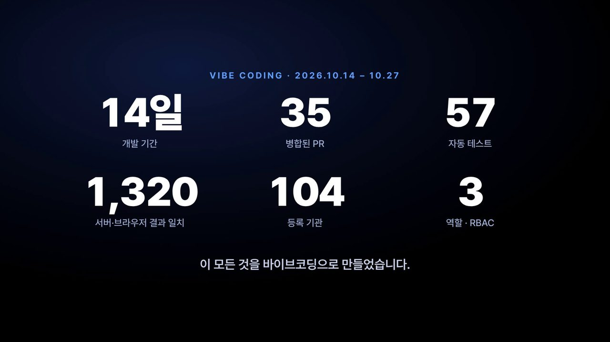
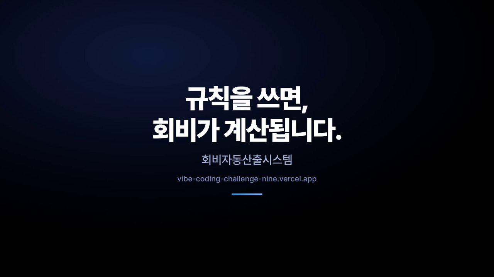
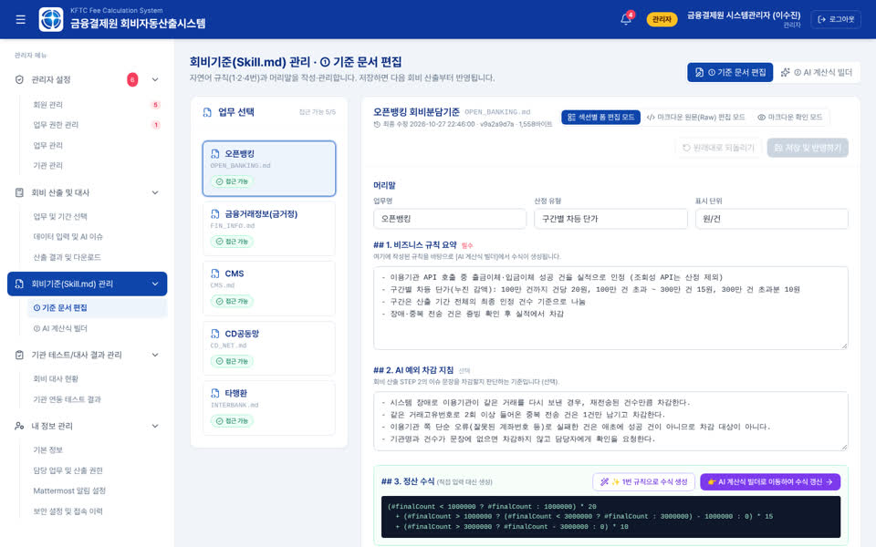
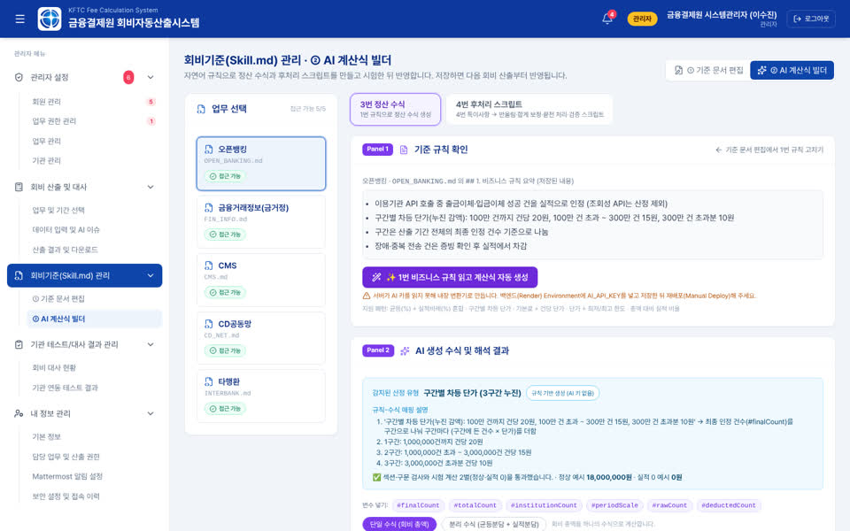
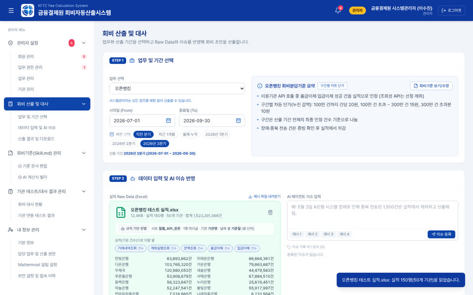
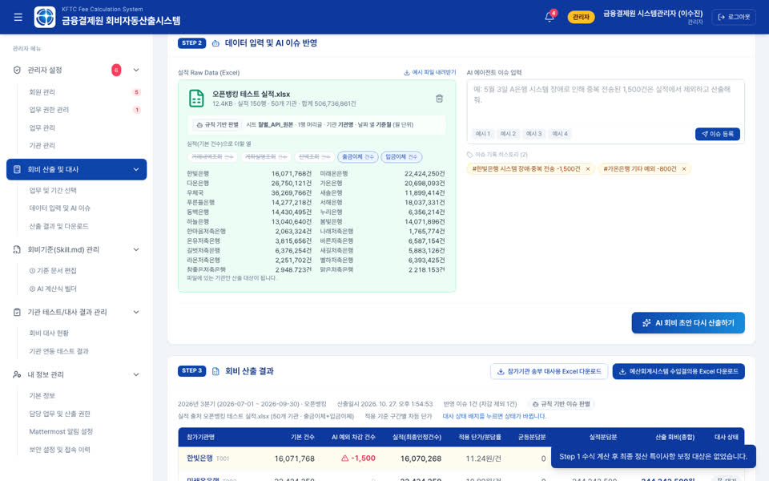
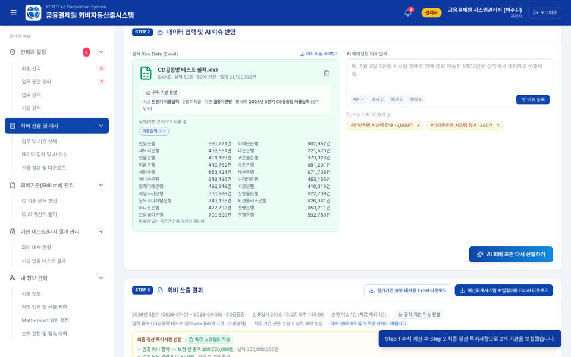
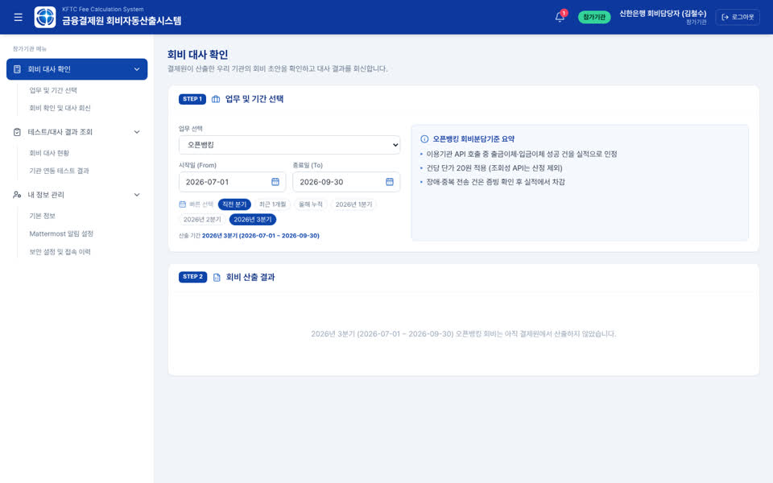

# Day03 — 회비자동산출시스템 최종 발표 시나리오 + 시연 영상 (대용)

- **날짜**: 2026-10-27
- **도구**: Claude Code (Playwright + Chromium 스크린캐스트, ffmpeg)
- **한 줄 소개**: 배포본(https://vibe-coding-challenge-nine.vercel.app/)의 기능을 실제 화면으로 분석해 심사 기준별 핵심 포인트를 뽑고, 2분 30초 키노트 문법의 발표 시나리오와 자막 입힌 시연 영상(1080p)을 만들었다.

## 만든 것

```
docs/
  scenario.md         발표 시나리오: 메시지 구조 · 기능 분석 · 심사 기준 매트릭스 · 초 단위 타임라인 · 내레이션 전문 · 리스크 · 확인 사항 · 1차 영상 실제 구간
  scenario.html       같은 내용의 웹 페이지 (화면 캡처 포함, 단일 파일)
  narration.txt       내레이션 대본 (발표자 낭독 · TTS용)
  narration.srt       영상과 시간이 맞는 자막 파일
  img/                로컬에서 찍은 앱 화면 캡처 8장 + 키노트 카드 4장
video/
  시연영상_v1_자막.mp4     카드 4장 + 실제 화면 시연 + 로어서드 + 내레이션 자막 (무음)
  시연영상_v1_무자막.mp4   내레이션 자막을 뺀 판 (발표자가 라이브로 읽을 때)
tools/
  cards.html          키노트 타이포 카드 4장 (문제 · 리빌 · 증거 · 끝), CSS 애니메이션
  record_cards.js     카드를 Chromium으로 렌더링해 세그먼트 mp4로 녹화
  record_demo.js      앱을 Playwright로 조작하며 한 테이크로 녹화 (가짜 커서 · 클릭 리플 · 하이라이트 · 로어서드 · 줌)
  recorder.js         CDP 스크린캐스트 프레임 → 30fps H.264 세그먼트 (비트 경계 marker 기록)
  assemble.py         세그먼트 이어 붙이기(딥 투 블랙) + 내레이션 자막(ASS) 굽기 + 무음 트랙 → 최종 mp4
  make_demo_files.py  테스트 실적 원본에 기간(년월) 정보만 더한 시연용 복사본 생성 (복사본은 커밋하지 않음)
```

영상 구성 (2분 35초, 155초): 문제 카드 → 리빌 카드 → 실제 화면 7비트(규칙 문서 · AI 수식 · 업로드 · AI 이슈 · 산출·검증 · 대사 · 참가기관 회신) → 증거 카드 → 끝 카드. 비트별 내용과 내레이션은 [docs/scenario.md](docs/scenario.md).

시연에 쓴 데이터는 모두 가상 예시(기관 T001~T058, O001~O046 등)이며, 테스트 실적 파일 자체는 저장소에 넣지 않았다.

## 사용한 프롬프트 / 과정

John의 요청: "배포 URL의 최종 아티팩트 기준으로 기능을 분석하고, 심사 평가 기준에 맞춰 핵심 기능·차별화 포인트를 프레젠테이션하는 시나리오를 짜자. 애플 혹은 최신 테크 기업의 문법에 맞추어 2분 30초 안을 만들고, 그걸 다듬어 시연 영상을 만들자. 시연에 필요한 테스트 실적 4종 첨부."

1. **기능 분석**: 작업 환경의 네트워크 정책이 vercel.app·onrender.com을 막아, 같은 `main` 코드를 로컬에서 Vite(프론트) + Spring Boot jar(백엔드)로 띄우고 담당자·관리자·참가기관 세 계정으로 전 메뉴를 열어 캡처했다. 테스트 실적 4종을 실제로 올려 산출 E2E를 돌려 결과 수치를 확인했다(오픈뱅킹 조회 3열 제외 시 506,736,861건, CD공동망 합계 300,000,000원 ✓, 타행환 200,229,612원 ✓, 기업회계→금거정 4~6월 210행 기간 밖 제외).
2. **시나리오**: 저장소에 심사 기준 문서가 없어 일반적인 다섯 기준(문제 정의·완성도·창의성·AI 활용·전달력)을 가정하고 기능↔기준 매트릭스를 만든 뒤, "문제 한 줄 → 전환 한 줄 → 증명" 구조로 10비트 타임라인과 약 670자 내레이션을 썼다. 웹 페이지로 게시해 피드백을 받는다.
3. **영상**: 키노트 카드는 HTML/CSS 애니메이션을 Chromium에서 녹화했고, 시연은 Playwright가 실제 앱을 조작하는 동안 CDP 스크린캐스트로 프레임을 받아 30fps로 인코딩했다. 화면 위 커서·리플·하이라이트·로어서드·줌은 페이지에 주입한 오버레이. 비트 경계를 marker로 남겨 내레이션 자막 시간을 자동 배분하고 ffmpeg로 이어 붙였다.

## 다시 만들기

```bash
# 1) 앱 띄우기 (저장소 루트에서)
cd day01-gyeongsik-fee-calculator/backend && mvn -q -DskipTests package && PORT=8080 java -jar target/fee-calc-backend-0.0.1-SNAPSHOT.jar &
cd day01-gyeongsik-fee-calculator && npm install && VITE_API_BASE_URL=http://localhost:8080 npm run dev -- --host 127.0.0.1 --port 5173 &

# 2) 시연용 실적 파일 (원본 4개 → demo-files/, 커밋하지 않음)
cd day03-daeyong-final-pitch
python3 tools/make_demo_files.py <CD공동망.xlsx> <타행환.xlsx> <기업회계.xlsx> <오픈뱅킹.xlsx> demo-files

# 3) 녹화 → 조립 (Node 18+, playwright, ffmpeg, 한글 글꼴 Pretendard 설치 필요)
cd tools && node record_cards.js && node record_demo.js && python3 assemble.py --demo-speed 1.3
# 결과: tools/out/final/시연영상_v1_자막.mp4, 시연영상_v1_무자막.mp4, narration.ass/.srt/.txt, timeline.json
```

`record_demo.js`는 `APP_URL`(기본 http://127.0.0.1:5173/)과 `DEMO_FILES_DIR`(기본 `../demo-files`) 환경변수를 읽는다. 녹화 중에는 앱 소스를 바꾸지 말 것(Vite HMR로 화면 상태가 초기화된다).

## 배운 점

- **배포 주소가 막혀도 같은 코드를 띄우면 된다.** 분석·녹화는 로컬 실행으로 충분했지만, AI 키가 없어 화면 배지가 "규칙 기반"으로 찍힌다. 실제 AI 표시로 찍으려면 배포 주소 허용 또는 키가 필요하다.
- **파일은 "기간"이 있어야 읽힌다.** 테스트 실적 4종 중 3종(CD공동망·타행환·기업회계)은 날짜 정보가 없어 그대로는 거부된다. 제목 행 또는 머리글에 년월만 넣으면 분기·월 단위로 인식한다.
- **녹화 중 코드 동기화 금지.** 1차 테이크 도중 `main`을 병합했더니 Vite HMR이 App 상태를 초기화해 로그인 화면으로 돌아갔다. 녹화 전에 동기화를 끝내고, 녹화 중에는 저장소를 건드리지 않는다.
- **Playwright 한글 파일명 업로드.** `setInputFiles(경로)`는 한글 경로에서 조용히 0개 파일을 넣는다. `{ name, mimeType, buffer }`로 넘겨야 한다.
- **응답 대기는 클릭보다 먼저 건다.** 산출 응답이 1초 안에 오면 클릭 뒤에 건 `waitForResponse`는 영영 기다린다.
- **스크린캐스트 + 심장박동 요소.** 정지 화면에서는 CDP가 프레임을 보내지 않으므로 1픽셀 요소를 깜빡여 프레임 간격을 보장했다. Playwright 내장 녹화(VP8)보다 글자가 선명하다.

## 스크린샷

| 문제 카드 | 리빌 카드 | 증거 카드 | 끝 카드 |
|---|---|---|---|
|  |  |  |  |

| 기준 문서 편집 (skill.md 4섹션) | AI 계산식 빌더 (생성 결과 · 3단계 검증) |
|---|---|
|  |  |

| 형식 자유 업로드 (오픈뱅킹 150행 판별) | 산출 결과 (차감 · 차감 제외 근거) |
|---|---|
|  |  |

| CD공동망 결과 (특이사항 보정 · 합계 검증 ✓) | 참가기관 뷰 (자기 기관 행 · 대사 회신) |
|---|---|
|  |  |
