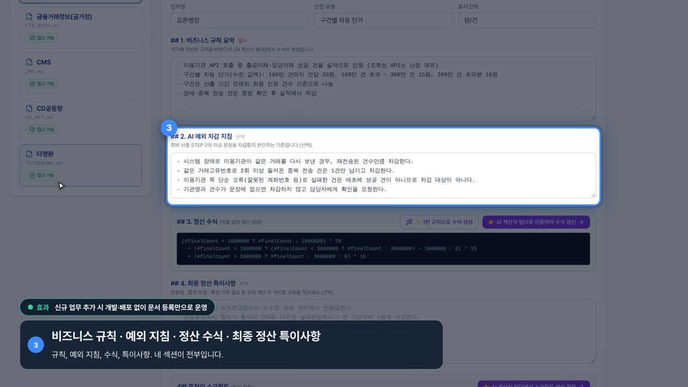
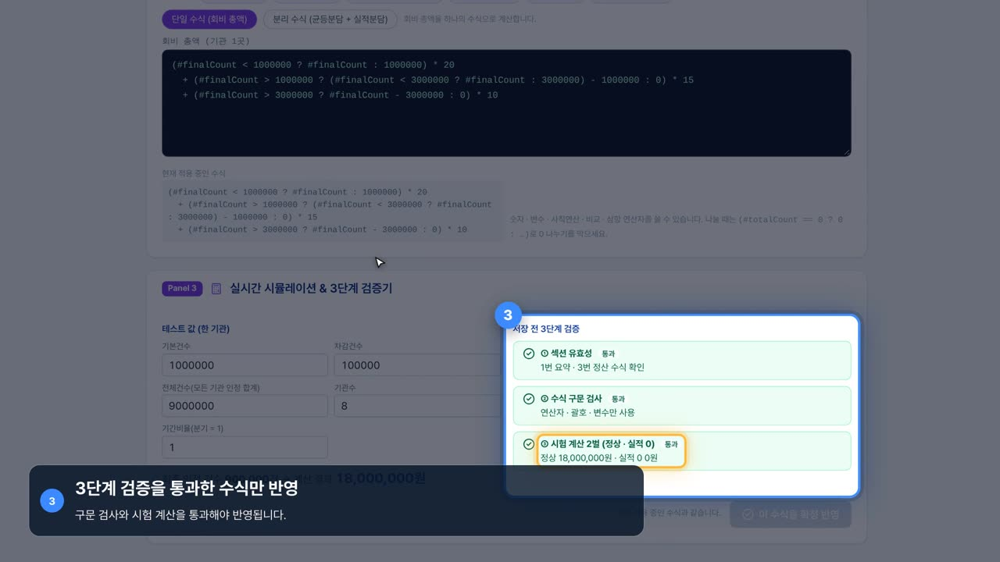
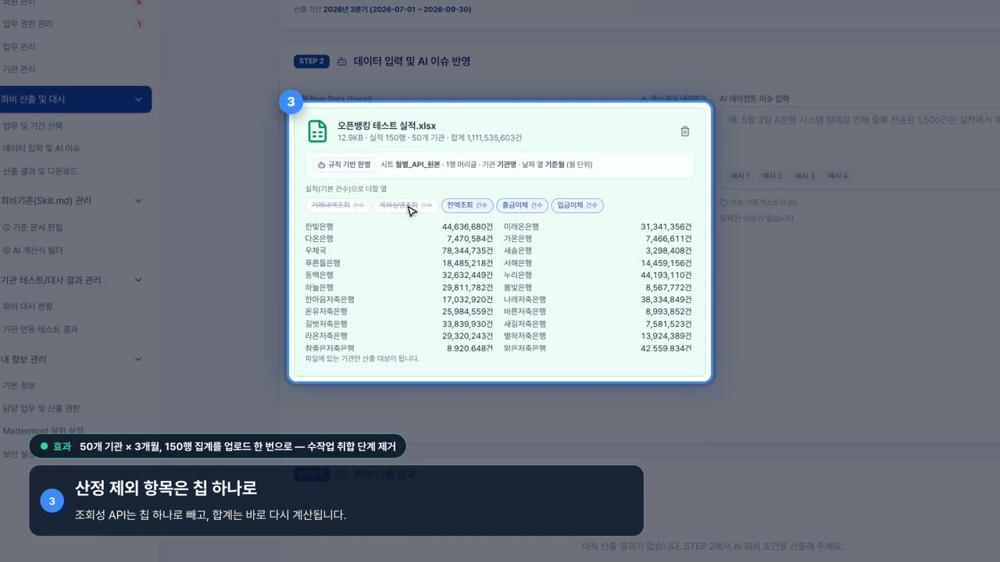
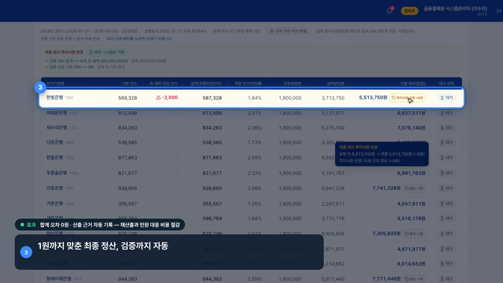
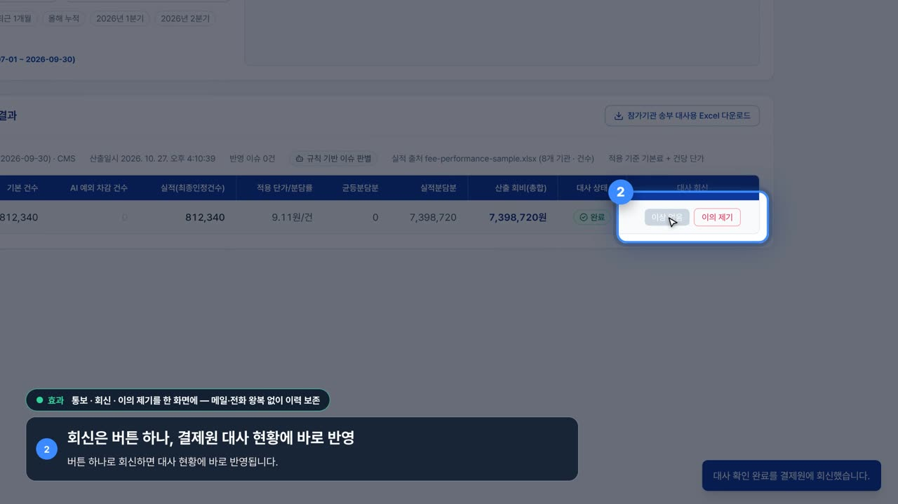
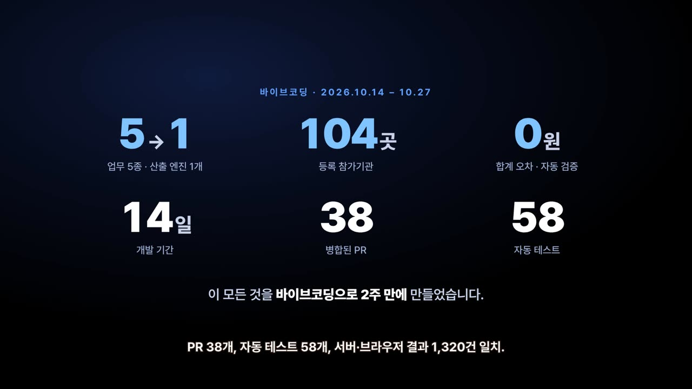

# Day04 — 회비자동산출시스템 시연 영상 v2: 모듈형 제작 체계 (석용)

- **날짜**: 2026-10-27
- **도구**: Claude Code (Playwright + Chromium 스크린캐스트, ffmpeg/libass, Pretendard)
- **한 줄 소개**: 시연 영상을 화면(기능) 단위 모듈로 나누어, 고칠 부분만 다시 찍고 다시 이어 붙이는 제작 체계로 바꿨다. C-level이 보는 영상이므로 자막 문구를 다듬고, 기능마다 사업 효과 코멘트를 붙였으며, 자막이 말하는 화면 영역만 밝게 남기는 스포트라이트 연출로 "코멘트 ↔ 강조 화면"을 일치시켰다.

## 만든 것

```
video/
  시연영상_v2_자막.mp4      전체 영상 2분 39초, 1080p (자막 패널 + 내레이션 자막, 무음)   ← 제출용
  시연영상_v2_무자막.mp4    자막 패널의 내레이션 대신 요약 한 줄 (발표자가 라이브로 읽을 때)
  modules/<모듈>.mp4        모듈별 자막 클립 11개 (검토·부분 교체용)
modules/                    모듈 = 폴더 하나. 순서는 order.json
  00-problem/ 01-reveal/ 80-proof/ 90-closing/   카드 모듈: card.html(타이포 카드) + module.js(길이) + captions.json(내레이션)
  10-rules-doc/ 20-ai-formula/ 30-upload/ 40-ai-issue/ 50-calc-verify/ 60-reconcile/ 70-institution/
                            화면 모듈: module.js(앱 조작 + 비트별 스포트라이트) + captions.json(비트별 제목·요약·효과·내레이션)
tools/
  record.js                 모듈 단위 녹화  (node record.js [모듈 id …])
  assemble.py               모듈 클립 → 크로스페이드로 이어 붙이고 자막 패널(ASS)을 굽는다. 모듈별 자막 클립도 생성
  storyboard.py             captions.json + 타임라인으로 docs/storyboard.md 생성
  make_demo_files.py        시연용 실적 파일 4종 생성 (가상 데이터, 고정 시드)
  lib/overlay.js            스포트라이트·번호 배지·카메라 줌·커서·클릭 리플·펄스
  lib/app.js                앱 조작 헬퍼 (로그인, 메뉴, 업로드, 이슈 등록, 산출 …) — 녹화 전 상태 준비에 사용
  lib/recorder.js           CDP 스크린캐스트 → 30fps H.264 클립 + 비트 경계 기록
docs/
  storyboard.md             모듈·비트별 제목/요약/효과/내레이션과 시각 (자동 생성)
  narration.srt / .txt      내레이션 자막 (시간 코드) / 낭독용 대본
  timeline.json             모듈·비트 시작·끝 시각
  img/                      검수용 프레임
```

## 제작 컨벤션 (앞으로 이 방식으로 이어간다)

### 1. 모듈 = 화면(큰 기능) 하나

| 순서 | 모듈 | 내용 | 효과 코멘트 |
|---|---|---|---|
| 1 | `00-problem` | 카드: 분기마다 반복되는 회비 산출, 업무 5종 · 기관 100여 곳 | |
| 2 | `01-reveal` | 카드: 회비자동산출시스템 — 규칙을 쓰면, 회비가 계산됩니다 | |
| 3 | `10-rules-doc` | 역할별 로그인 → 기준 문서 편집(4개 섹션) | 신규 업무 추가 시 개발·배포 없이 문서 등록만으로 운영 |
| 4 | `20-ai-formula` | AI 계산식 빌더: 문장 → 수식, 산정 유형·근거, 3단계 검증 | |
| 5 | `30-upload` | 업무·기간 선택 → 형식 자유 업로드 → 열 칩으로 제외 | 50개 기관 × 3개월, 150행 집계를 업로드 한 번으로 |
| 6 | `40-ai-issue` | 예외를 문장으로 등록, 지침에 맞는 이슈만 차감 | |
| 7 | `50-calc-verify` | 산출 → 차감 행 → 차감 제외 근거 → CD공동망 10원 절상·절삭·합계 3억 검증 ✓ | 합계 오차 0원 · 산출 근거 자동 기록 |
| 8 | `60-reconcile` | 대사용·수입결의용 엑셀 → 타행환·금거정 몽타주 | 업무 5종을 산출 엔진 1개로 |
| 9 | `70-institution` | 참가기관 로그인 → 자기 회비만 → 이상 없음 회신 | 통보·회신·이의 제기를 한 화면에 |
| 10 | `80-proof` | 카드: 5→1 · 104곳 · 0원 / 14일 · PR 38 · 테스트 58 | |
| 11 | `90-closing` | 카드: 슬로건 · 제품명 · 주소 | |

- 한 모듈은 새 브라우저 페이지에서 `setup()`(상태 준비, 녹화 안 함) → `run()`(녹화)으로 처음부터 재현되므로 **그 모듈만 다시 찍을 수 있다**.
- 모듈 안은 **비트(beat)** 로 나뉜다. 비트 하나 = 스포트라이트 영역 하나 = 자막 패널 하나. `module.js` 의 `beat('b1', …)` 안에서 `ov.focus(요소, { badge: 1 })` 로 영역을 비추고, `captions.json` 의 같은 `b1` 에 제목·요약·효과·내레이션을 쓴다.
- 번호 배지: 화면의 스포트라이트 왼쪽 위와 자막 패널 왼쪽에 **같은 번호**가 붙는다. 자막이 가리키는 영역이 곧 밝게 남은 영역이다 (v1 피드백 "코멘트에 맞는 화면이 강조되지 않는 느낌" 대응).

### 2. 고치는 방법

| 고칠 것 | 할 일 | 걸리는 시간 |
|---|---|---|
| 자막 문구·효과 코멘트·내레이션 | `modules/<모듈>/captions.json` 수정 → `python3 tools/assemble.py && python3 tools/storyboard.py` | 2–3분 (다시 찍지 않음) |
| 한 모듈의 화면 동작·강조 위치 | `modules/<모듈>/module.js` 수정 → `node tools/record.js <모듈>` → `assemble.py` | 모듈당 1–2분 + 조립 |
| 카드 문구·디자인 | `modules/<카드>/card.html` 수정 → `node tools/record.js <카드>` → `assemble.py` | 1분 + 조립 |
| 모듈 추가·순서·배속 | 폴더 복사 후 `modules/order.json` 에 추가 (`speed` 로 모듈별 배속) | |

### 3. 자막 패널 디자인

- 화면 모듈: 왼쪽 아래 둥근 패널 `[번호] 제목` + 아랫줄(자막판: 내레이션 문장이 바뀜 / 무자막판: 요약 한 줄). 효과 코멘트는 패널 위 초록 칩 `● 효과 …` (비트 시작 0.5초 뒤 등장).
- 카드 모듈: 가운데 아래 내레이션 자막만.
- 글꼴 Pretendard, 제목 40px ExtraBold, 본문 27px. 자막은 전부 ASS 텍스트로 조립 때 굽는다 → 영상을 다시 찍지 않고 문구를 바꿀 수 있다.
- 문장 길이가 비트 길이에 비해 길면(초당 6.5자 초과) `assemble.py` 가 경고한다.

## 다시 만들기

```bash
# 0) 글꼴: Pretendard 설치 (fc-list | grep Pretendard 로 확인). 없으면 자막이 기본 글꼴로 나온다
mkdir -p ~/.local/share/fonts/pretendard /tmp/pretendard && cd /tmp/pretendard \
  && curl -sL -o pretendard.zip https://github.com/orioncactus/pretendard/releases/download/v1.3.9/Pretendard-1.3.9.zip \
  && unzip -q -o pretendard.zip && find . -name 'Pretendard-*.otf' -exec cp {} ~/.local/share/fonts/pretendard/ \; && fc-cache -f && cd -
# 1) 앱 띄우기 (저장소 루트에서)
cd day01-gyeongsik-fee-calculator/backend && mvn -q -DskipTests package && PORT=8080 java -jar target/fee-calc-backend-0.0.1-SNAPSHOT.jar &
cd day01-gyeongsik-fee-calculator && npm install && VITE_API_BASE_URL=http://localhost:8080 npm run dev -- --host 127.0.0.1 --port 5173 &

# 2) 시연용 실적 파일 (demo-files/, 커밋하지 않음). 실제 테스트 실적 원본이 있으면 같은 이름으로 이 폴더에 두면 된다
cd day04-seokyong-demo-video && python3 tools/make_demo_files.py

# 3) 녹화 → 조립 → 스토리보드 (Node 18+, playwright, ffmpeg, python3 + openpyxl·Pillow)
node tools/record.js                 # 전부 (약 10분). 일부만: node tools/record.js 30-upload 40-ai-issue
python3 tools/assemble.py            # video/시연영상_v2_자막.mp4 · 무자막.mp4 · video/modules/*.mp4 · docs/narration.*
python3 tools/storyboard.py          # docs/storyboard.md
# 검토용: python3 tools/assemble.py --modules 30-upload,40-ai-issue  → tools/out/modules/preview_*.mp4
```

의존성: Node 18+ 와 `playwright`(Chromium 포함), `ffmpeg`(libass 포함), `python3` + `openpyxl`·`Pillow`, `fontconfig`(fc-match). 이 작업 환경(클라우드 세션)에는 모두 미리 설치돼 있고 글꼴만 0)으로 넣으면 된다. 다른 PC라면 `npm i playwright && npx playwright install chromium`, `pip3 install openpyxl pillow` 로 맞춘다.

`record.js` 는 `APP_URL`(기본 http://127.0.0.1:5173/)과 `DEMO_FILES_DIR`(기본 `demo-files/`)을 읽는다. 녹화 중에는 앱 소스를 바꾸지 말 것(Vite HMR 로 화면 상태가 초기화된다).

## 사용한 프롬프트 / 과정

John의 요청: "(1) 각 기능의 시연영상을 화면(큰 기능)별로 모듈화해서 수정이 필요한 부분만 애자일하게 고치자. (2) C-level 이 볼 것이라 아래 설명 글자를 더 예쁘게. (3) 사업적으로 정량·정성 효과를 설명하는 코멘트 한두 개. (4) 줌인은 좋은데 코멘트에 맞는 화면이 강조되지 않는다 — 전체 re-design."

1. **모듈화**: v1 은 시연 전체가 한 테이크(`record_demo.js` 한 파일)라 한 장면을 고치려면 2분 35초를 다시 찍어야 했다. v2 는 모듈마다 `setup()` 이 앱 상태를 처음부터 만들고(`lib/app.js`), `run()` 만 녹화한다. 조립은 모듈 클립을 크로스페이드로 잇고 자막을 얹는다.
2. **자막 재설계**: 로어서드(화면 안 DOM)와 내레이션 자막(ASS)이 겹치던 v1 두 층을 패널 하나로 합쳤다. 자막 전부를 텍스트(`captions.json`)로 빼서 문구 수정에 재녹화가 필요 없게 했다. 문구는 내부 용어(skill.md·SpEL·RBAC·Mock)를 빼고 결과 중심으로 다시 썼다.
3. **효과 코멘트**: 수치로 말할 수 있는 것(150행 업로드 한 번, 합계 오차 0원, 업무 5종 → 엔진 1개)과 정성 효과(문서 등록만으로 운영, 회신·이의 제기 이력 보존) 4개를 골라 해당 기능 비트에 칩으로 붙였다. 증거 카드도 사업 효과 3개(5→1 · 104곳 · 0원) + 개발 증거 3개(14일 · PR 38 · 테스트 58)로 재구성했다.
4. **강조 재설계**: v1 의 줌은 요소 중심 확대만이라 자막이 가리키는 곳이 분명하지 않았다. v2 는 (a) 대상 영역 밖을 어둡게, (b) 영역이 화면 위쪽 가운데에 오도록 줌·이동, (c) 영역과 자막 패널에 같은 번호 배지. 세부 요소는 노란 펄스로 한 번 더 짚는다.

## 가정 (확인 필요)

- **테스트 실적 파일**: v1 에 쓴 John 첨부 파일 4종이 이 작업 공간에 없어, 같은 구조(오픈뱅킹 기준월·기관명·API 5열 150행, CD공동망·타행환 제목 행 + 기관코드·기관명·이용실적, 기업회계 월별 머리글)의 가상 파일을 `make_demo_files.py` 로 생성해 녹화했다. 실제 파일로 찍으려면 `demo-files/` 에 같은 이름으로 두고 다시 녹화하면 된다.
- **AI 배지**: 작업 환경에서 배포 주소(vercel.app·onrender.com)가 막혀 같은 `main` 코드를 로컬에서 띄웠고 AI 키가 없어 화면에 "규칙 기반" 배지가 찍힌다. 실제 AI 표시로 찍으려면 `AI_API_KEY` 를 넣은 백엔드로 `APP_URL` 을 바꿔 다시 녹화한다.
- **심사 배점표·발표 형식**: 아직 없어 v1 과 같은 다섯 기준 가정(문제 정의·완성도·창의성·AI 활용·전달력)과 "자막판 제출, 무자막판은 발표자 낭독" 전제를 유지했다.
- **효과 코멘트의 수치**: 시스템에서 확인되는 값(150행, 0원 검증, 업무 5종, 기관 104곳)만 썼고, 현업의 수작업 시간 절감 같은 추정치는 근거 자료가 없어 넣지 않았다. 필요하면 `captions.json` 의 `effect` 한 줄을 바꾸면 된다.

## 배운 점

- **상태 준비와 녹화를 분리하면 모듈이 독립된다.** 산출 결과는 페이지 상태(React)에만 있어 새 페이지에서는 사라진다. 모듈마다 setup 이 업로드·이슈·산출을 다시 만들어 두면(수 초) 어느 모듈이든 혼자 다시 찍을 수 있다.
- **산출 응답 뒤에도 화면은 몇 초 뒤에 결과를 넣는다.** 진행 메시지 타이머가 끝나기 전에 로그아웃하면 결과가 버려진다. 표가 뜰 때까지 기다리는 `waitFor` 가 필요했다.
- **줌 아래 오버레이는 좌표계를 나눠야 한다.** 커서·리플은 뷰포트 좌표(html 아래), 스포트라이트·배지는 body 안(줌과 함께 이동). body 가 확대된 상태에서 요소 위치를 재면 역변환해야 한다.
- **자막은 영상 밖에 둔다.** 문구를 영상 안(DOM)에 찍으면 한 글자 고칠 때도 다시 찍어야 한다. ASS 로 조립 때 굽고 도형(둥근 패널·배지·칩)까지 ASS 드로잉으로 그리면 디자인을 유지하면서 텍스트만 바꿀 수 있다.
- **데이터가 우연히 '깨끗'하면 연출이 사라진다.** 첫 기관 회비가 우연히 10원 단위라 절상 배지가 안 떴다. 시연 데이터는 보여 줄 규칙이 실제로 발동하도록 값을 고정한다(`make_demo_files.py` 의 override).

## 스크린샷

| 문제 카드 | 리빌 카드 |
|---|---|
|  |  |

| 기준 문서 4개 섹션 (스포트라이트 + 번호 배지 + 효과 칩) | AI 계산식 빌더 3단계 검증 |
|---|---|
|  |  |

| 형식 자유 업로드 · 열 칩 | 산출 결과 · CD공동망 검증 ✓ |
|---|---|
|  |  |

| 참가기관 회신 | 증거 카드 |
|---|---|
|  |  |
